# meshcode

[English](README.md)

Escribe modelos 3D e imágenes 2D como código, míralos en vivo y expórtalos como GLB, PNG o código de motor. O convierte un GLB de vuelta en código.

**▶ Pruébalo en itch.io: [meshcode](ITCH_IO_URL)** <!-- reemplaza ITCH_IO_URL por el enlace de la página de itch.io -->

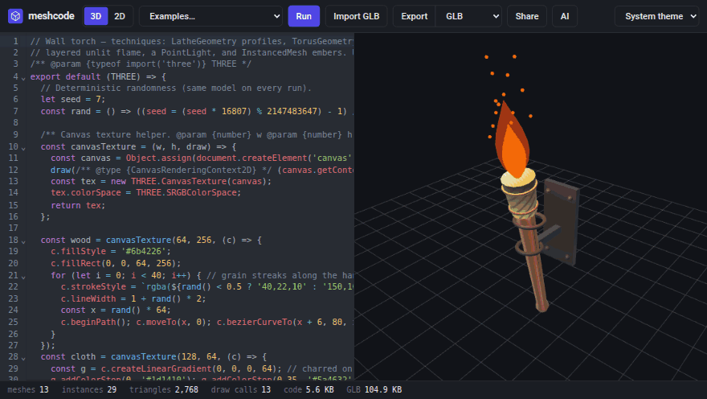

<sub>Grabado con `pnpm demo:gif` (Chrome headless + ImageMagick).</sub>

El proyecto tiene dos partes:

- **[La app](#la-app)**: un editor de código con vista previa 3D/2D en vivo que se ejecuta en el navegador.
- **[La investigación](#investigación-archivos-híbrido-o-código)**: un benchmark abierto que responde una pregunta: **¿es más eficiente entregar los assets de un juego como archivos (GLB/PNG), como código o como un híbrido de ambos?** Los agentes de IA que programan construyen cada vez más juegos sin ningún archivo de assets: cada malla, textura y efecto es código. Este estudio mide cuánto cuesta eso en tiempo de ejecución.

> Estado: **en desarrollo**. La app (3D + 2D), la exportación a motores, la IA opcional, la CLI y el benchmark en PC están terminados. Falta: medir en un teléfono Android real y el análisis final (intervalos de confianza por bootstrap).

<!-- ## Hoja de ruta

- [x] 1. Esqueleto del repo + dossier de investigación
- [x] 2. `meshcode build` (código → GLB)
- [x] 3. `meshcode decompile` (GLB → código) + métrica de fidelidad por IoU de siluetas (+ refinamiento con `--llm`, 3.9)
- [x] 3.5. App web + PWA
- [x] 3.6. Tema claro/oscuro + ejemplos detallados
- [x] 3.7. Modo 2D: imágenes desde código (Canvas, SVG, HTML/CSS → PNG/JPG/WebP)
- [x] 3.8. Exportación a motores: Godot (GDScript), Unity (C#, experimental); Unreal vía GLB
- [x] 3.9. IA opcional: modelos locales o tu propia API key (generar, reparar, refinar importaciones)
- [x] 3.10. GIF de demo en el README
- [x] 3.11. Modelo ↔ código: clic en una pieza para seleccionar su código, cursor para marcar piezas
- [x] 3.12. Animación 3D desde código (piezas rígidas → keyframes en el GLB)
- [x] 4. Juego de benchmark en tres variantes (estudio controlado + con assets reales)
- [ ] 5. Arnés de medición (PC hecho, Android pendiente)
- [ ] 6. Análisis, gráficas, release + DOI -->

## La app

### Qué es

meshcode es un editor donde un modelo 3D o una imagen 2D **es un archivo pequeño de código**: un módulo de three.js para 3D, y un script de Canvas, SVG o HTML/CSS para 2D. Escribes el código de un lado y ves el resultado en vivo del otro. No hay nada que instalar, ni cuenta, ni servidor: todo se ejecuta en tu navegador.

### Qué hace

| | |
|---|---|
| **Modelos 3D desde código** | Ejecuta un módulo de three.js y lo muestra en vivo con controles de órbita. El pie cuenta mallas, instancias, triángulos y draw calls, y compara el tamaño del código con el del GLB exportado. |
| **Exportar** | GLB (con animación), GDScript de Godot 4 (`.gd`) o C# de Unity (`.cs`) en 3D; PNG, JPG, WebP (o el SVG tal cual) en 2D. |
| **GLB → código** | **Import GLB** (o soltar un `.glb` en cualquier parte) convierte un modelo en código editable y comprueba que ese código reconstruye el mismo modelo. |
| **Imágenes 2D desde código** | Canvas, SVG o HTML/CSS → imágenes, sprite sheets y clips de animación. |
| **Modelo ↔ código** | Haz clic en una pieza de la vista previa para seleccionar el código que la creó; mueve el cursor en el código para marcar las piezas que crea ese bloque. |
| **Animación** | Un export `animate` mueve piezas en el tiempo; se exporta como animación glTF. |
| **Share** | Un enlace que contiene el código (comprimido en la URL). No se sube nada. |
| **IA (opcional)** | Genera o edita código a partir de una descripción, con un modelo local (Ollama, LM Studio…) o tu propia API key. |

### Cómo se usa

1. Abre la [página de itch.io](ITCH_IO_URL) y ejecuta la app en el navegador.
2. Elige **3D** o **2D** arriba. Abre **Examples…** para cargar un modelo o una imagen de ejemplo.
3. Edita el código de la izquierda. La vista previa se actualiza mientras escribes (o pulsa **Run** / `Ctrl+Enter`). Los errores aparecen sobre la vista previa.
4. En 3D, arrastra para orbitar, usa la rueda para acercar y haz clic en una pieza para saltar a su código.
5. Elige un formato junto a **Export** y pulsa **Export** para descargar el archivo.
6. Para partir de un modelo existente, pulsa **Import GLB** o suelta un `.glb` en la página.
7. **Share** copia un enlace con tu código dentro. En itch.io el enlace abre meshcode en su propia página (itch.io no le pasa al juego los datos del enlace); si el navegador bloquea la copia ahí, el enlace aparece en un cuadro para copiarlo a mano.
8. Opcional: **AI** abre una barra para escribir lo que quieres; el proveedor se configura en **Settings** (ver [IA](#ia-opcional)).

Distribución: arrastra el título **⠿ Code** o **⠿ Preview** a cualquier lado (o usa el selector), arrastra el divisor para cambiar el tamaño y elige tema claro u oscuro. En 2D, la barra de la vista previa elige el clip de animación, lo pausa, cambia entre filtrado suave y nítido (pixel art) y muestra el sprite sheet completo. Tu último código de cada modo se guarda en este navegador.

Un modelo 3D es un módulo ES cuyo export por defecto recibe `THREE` y devuelve cualquier `Object3D`:

```js
export default (THREE) => new THREE.Mesh(new THREE.BoxGeometry(1, 1, 1), new THREE.MeshStandardMaterial());
```

Tu código se ejecuta en un iframe aislado (origen opaco), así que un enlace compartido no puede leer el almacenamiento de la app ni tocar la página. Dentro del sandbox usa el argumento `THREE`; ahí no están disponibles los `import`.

### Ejecutarla en local

```sh
pnpm dev       # http://localhost:5173
pnpm build     # → dist/ (archivos estáticos; se instala como PWA, funciona sin conexión y abre archivos .glb)
pnpm itch      # build + zip → meshcode-web.zip, listo para subir a itch.io como proyecto HTML
```

## Investigación: ¿archivos, híbrido o código?

**Pregunta:** en un juego 3D web, ¿qué rinde mejor: assets entregados como archivos, assets generados por código en tiempo de ejecución o una mezcla? El cuaderno de laboratorio completo está en [`research/bitacora.md`](research/bitacora.md); las fuentes anotadas, en [`research/fuentes.md`](research/fuentes.md) y [`research/referencias.bib`](research/referencias.bib).

### Diseño

Un shooter de arena original que se juega solo: 40 drones, 83 cajas, 60 barriles, 3000 partículas de polvo y una cámara-bot que dispara 12,5 proyectiles por segundo (unos 816 000 triángulos y 80 draw calls por frame). Se construye en tres variantes que **solo difieren en de dónde salen los assets**:

| | **A · files** | **B · hybrid** | **C · code** |
|---|---|---|---|
| modelos + texturas | GLB (meshopt); PNG, WebP o KTX2 | GLB (meshopt); PNG, WebP o KTX2 | se construyen en runtime (three.js + canvas) |
| efectos | flipbook + sprite | shaders | shaders |
| layout del nivel | `layout.json` | generador con semilla | generador con semilla |

- **Una sola fuente de verdad.** Los archivos de A y B se hornean desde el código de C con meshcode, así que coinciden por construcción.
- **Mundo determinista.** Todo lo que se ve es una función del tiempo: cada variante hace el mismo trabajo por frame, a cualquier frame rate.
- **Control visual antes de medir.** Cada variante se compara con C píxel a píxel. Los umbrales se fijaron antes de la primera ejecución: PSNR ≥ 35 dB y ≥ 99 % de píxeles a ±8 niveles. Un control negativo (C un frame después) tiene que fallar, y falla. Las texturas ETC1S no pasaron y quedaron excluidas.
- **Estudio con assets reales.** Tres modelos CC0 hechos por artistas (`enemy-flying` de Kenney, `cargo_A` y `Barrel_A` de KayKit), entregados de tres formas: el GLB original, el código que produce `meshcode decompile` y una imitación paramétrica escrita a mano a partir de mediciones.
- **Medido con GPU real.** Chrome 158, AMD RX 6500 XT, Intel i3-13100F. 30 repeticiones por celda en orden aleatorio: 1440 cargas de página y 720 corridas de runtime. Tiempo de GPU con `EXT_disjoint_timer_query_webgl2`; VRAM real con el contador por proceso de amdgpu.

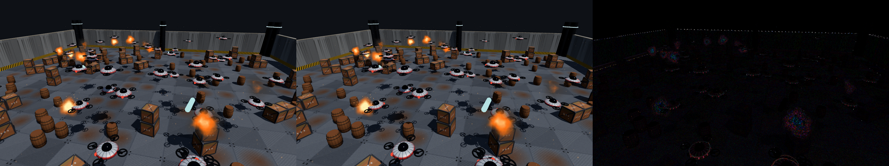

<sub>Variante código | variante archivos (WebP) | diferencia ×10. PSNR mínimo 48,9 dB: las variantes difieren entre 170 y 660 veces menos (MSE) que dos frames seguidos de la misma variante.</sub>

### Respuesta corta: ningún formato gana en todo

| pregunta | gana | margen |
|---|---|---|
| Bytes descargados | **código** | 160 KB frente a 736–3632 KB |
| Primera visita, red rápida | **código** | 528 ms frente a 678 ms (−22 %) |
| Primera visita, red 4G | **código** | 0,99 s frente a 1,7 s (WebP) y 4,6 s (PNG) |
| Visita repetida | archivos (WebP) | 261 ms; el código tarda un 16 % más |
| CPU 4× más lenta | archivos (WebP) | 756 ms; el código tarda un 9 % más |
| Costo de GPU por frame | **archivos** | files < hybrid < code: el código cuesta un 15 % (1080p) y un 23 % (4K) más |
| VRAM real | KTX2 / atlas reducido | solo 7–14 MiB de diferencia sobre unos 225 MiB por página |

**Hornear gana el frame y la segunda visita; el código gana la primera visita.** La recomendación de trabajo: el código como fuente y el archivo como runtime. En la web, entregar código directamente compensa cuando la primera visita es la que importa.

### Gráficas

#### Estudio controlado: bytes contra memoria de GPU

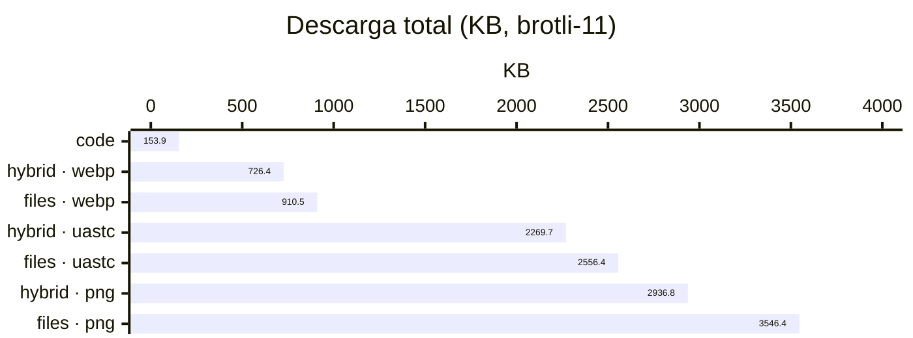

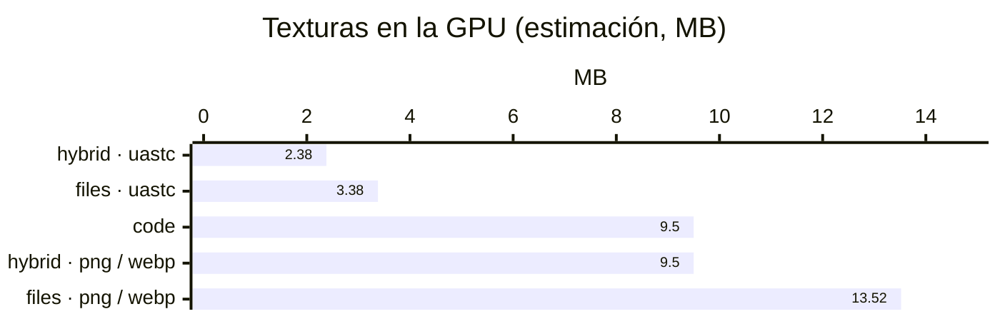

- **Los 5 modelos como código pesan 2,5 KB**; como GLB con WebP, 556 KB. Solo el cargador de GLB (18,6 KB) ya pesa más que todos los modelos en código.
- **WebP reduce la descarga, no la VRAM**: PNG y WebP se decodifican a RGBA, 4 bytes por píxel.
- **KTX2 (UASTC) usa 4× menos VRAM en texturas**, pero descarga más que WebP y añade 232 KB de transcoder, más que toda la variante código.

#### Assets reales: modelos de artistas frente a su imitación en código

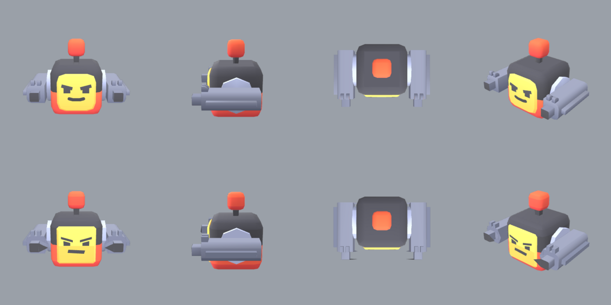

<sub>Dron de Kenney: original (arriba) e imitación en código (abajo). IoU de silueta 0,967, error de color 9,4 / 255.</sub>

| prop | silueta (IoU) | error de color | triángulos | líneas de código | iteraciones |
|---|---:|---:|---:|---:|---:|
| barril | 1,000 | 3,0 | 384 → 384 | 12 | 2 |
| caja | 1,000 | 4,3 | 128 → 128 | 19 | 2 |
| dron | 0,967 | 9,4 | 544 → 570 | 61 | 3 |
| kit compartido | — | — | — | 99 | — |

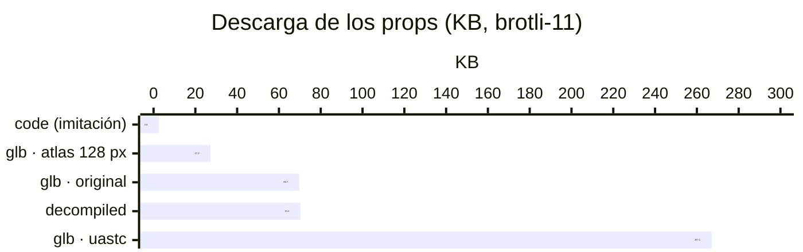

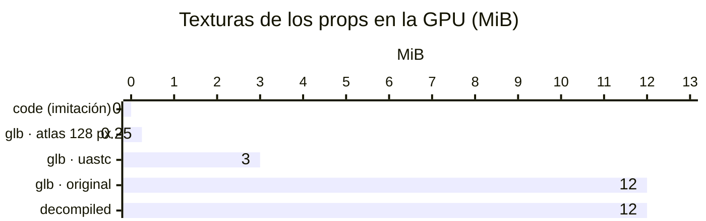

- **El arte low-poly ya es paramétrico**: la caja y el barril salen con la misma silueta exacta y el mismo número de triángulos que los originales.
- **Comparar contra el archivo tal como se exporta infla la ventaja del código.** Los atlas de paleta de 1024² ocupan 12 MiB de VRAM para unos 20 colores; reducidos a 128 px se ven igual (100 % de píxeles a ±8) y ocupan 0,25 MiB.
- **Un LLM local pequeño no lo consigue**: dolphin3 (8B), con solo una descripción en texto, produjo 0 imitaciones utilizables de 3.

#### Tiempo de carga con GPU real (ms hasta el primer frame, mediana de 30)

Primera visita = navegador nuevo, sin caché HTTP ni de shaders. Visita repetida = recarga con las cachés calientes. Fast 4G = 8,1 Mbps de bajada y 165 ms de RTT. CPU 4× = el hilo principal 4 veces más lento.

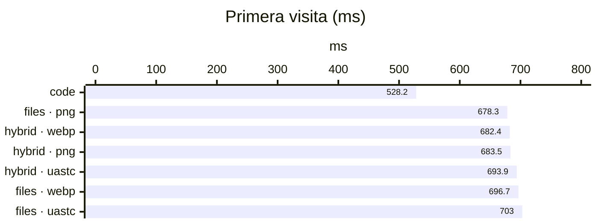

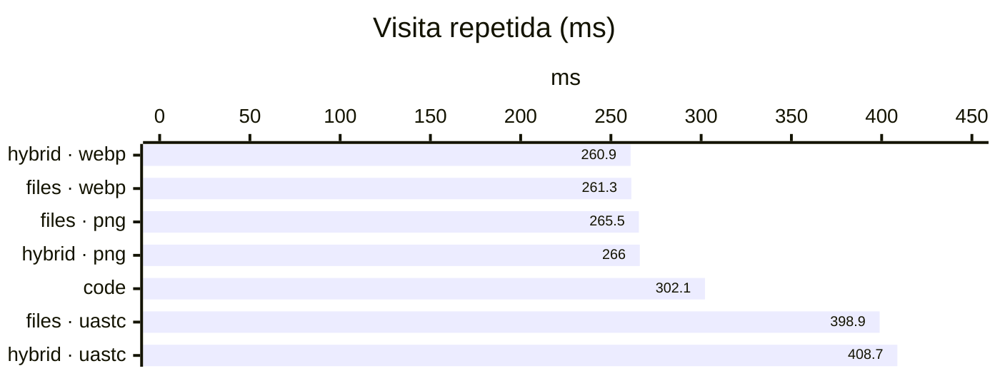

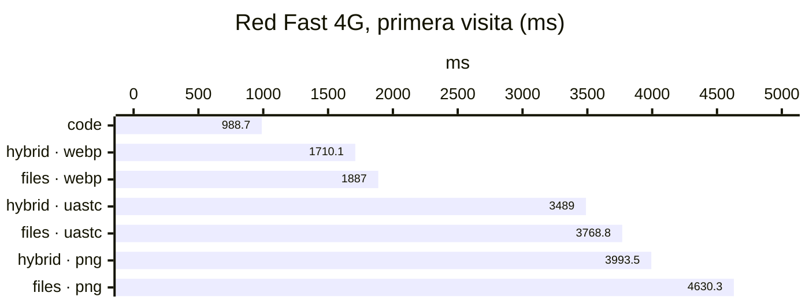

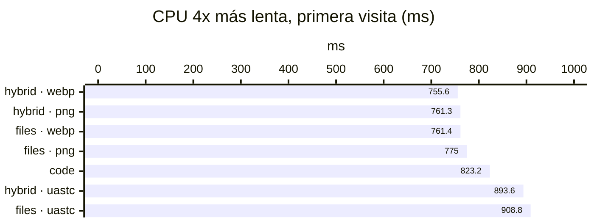

- **Cruce entre red y CPU.** Con red lenta el código llega primero (−42 % frente a WebP). Con la CPU lenta o en una visita repetida pierde (+9 % y +16 %): regenera todo en cada carga, mientras que los archivos salen de la caché.
- **KTX2 es la entrega más lenta en casi todo**: transcodificar en WASM añade unos 200 ms en la primera visita y 140 ms en la repetida.
- **Con arte real, las entregas empatan** (≤ 3 % de diferencia). La imitación en código es la más rápida en visita repetida (−13 %), porque sus props no tienen texturas.

#### Costo de GPU por frame (4K, sin vsync, mediana de 30)

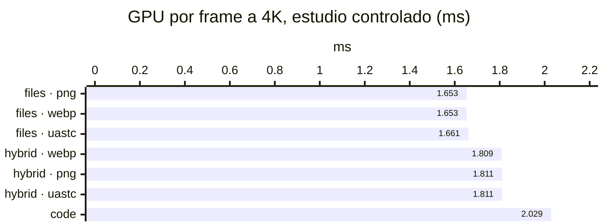

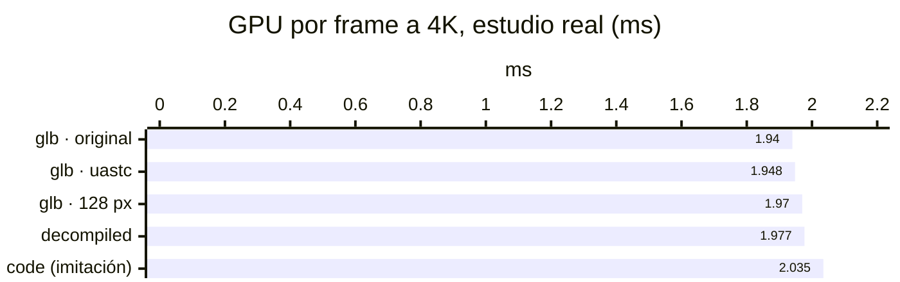

- **El formato de textura no cambia el costo por frame**: PNG, WebP y UASTC quedan a ≤ 0,5 % entre sí. KTX2 solo ahorra memoria.
- **Los efectos en shader cuestan GPU**: files y hybrid solo difieren en los efectos (flipbook frente a ruido procedural): +7 % a 1080p, +10 % a 4K, y crece con los píxeles.
- **Los modelos generados en código cuestan un 7–12 % más de GPU** que los mismos modelos en GLB, con los mismos triángulos, draw calls y programas. Todavía no está explicado (hipótesis: el orden de triángulos de meshopt, el estado de las texturas de canvas, la cuantización de atributos).
- En términos absolutos, la escena es ligera para esta GPU (todas las variantes superan los 380 fps a 4K). Los mismos porcentajes sí importarían en un móvil.

### Hallazgos principales

1. **Hornear gana el frame y la segunda visita; el código gana la primera visita.** Ningún formato gana en todo.
2. **El costo del código está en las texturas procedurales, no en la geometría procedural.** Con arte real low-poly (colores por vértice, sin texturas) la imitación en código empata con el GLB en la primera visita y lo supera en la repetida.
3. **Un detalle de implementación puede invertir la conclusión.** Por defecto Chrome dibuja el canvas 2D en la GPU, y eso le costaba a la variante código 30 MiB de VRAM y 140 ms en la primera visita. Con una sola opción (`getContext('2d', { willReadFrequently: true })`) pasó de perder a ganar.
4. **Lo compacto es la descripción, no el lenguaje.** El código decompilado automáticamente pesa lo mismo que el GLB. Solo el código paramétrico (un torno, una caja redondeada) es pequeño, y escribirlo exige entender la forma.

### Límites

Un solo PC y todavía ningún móvil; «CPU 4×» ralentiza el hilo principal, no la GPU ni los workers. Los props reales son tres modelos low-poly: no hay personajes, mallas orgánicas ni *skinning*. Las imitaciones las escribió un agente de IA de frontera con acceso a los originales, lo que equivale a convertir un asset, no a crearlo desde cero. La máquina no estaba dedicada (el arnés esperaba a que bajara la carga del sistema antes de cada medición). Quedan dos diferencias sin explicar: +7–12 % de GPU y +9 MiB de VRAM en los modelos generados en código.

### Reproducir

```sh
pnpm bench:build                # hornea los assets y construye las 3 páginas del juego
pnpm bench:check [--set real]   # control de equivalencia visual
pnpm bench:real                 # control por modelo de las imitaciones
pnpm bench:static [--set real]  # bytes y VRAM estimada
pnpm bench:run                  # medición con GPU real (~3,5 h)
pnpm bench:preview              # ver el juego en http://localhost:4173
```

Detalles en [`bench/README.md`](bench/README.md). Resultados: [`bench/results/`](bench/results/) (tablas completas con IQR en [`run/summary.md`](bench/results/run/summary.md), filas en crudo en `loads.csv` y `runtime.csv`).

## Animación: piezas que se mueven desde código

Añade un export `animate` para mover, rotar o escalar piezas en el tiempo. meshcode lo muestrea (`fps`, 30 por defecto) en keyframes: el visor los reproduce en bucle y **Export GLB** (y `meshcode build`) los escribe como animación glTF, que Blender, Godot, Unity y Unreal importan.

```js
export const duration = 3; // segundos
export const animate = (root, t) => {
  // valores absolutos a partir de t (sin `+=`); busca las piezas por nombre. t = 0 es la pose de reposo.
  root.getObjectByName('lid_hinge').rotation.x = -1.1 * (0.5 + 0.5 * Math.cos((2 * Math.PI * t) / duration));
};
export default (THREE) => { /* … */ };
```

Solo se animan posición/rotación/escala de los nodos (sin esqueletos, ni por instancia, ni materiales). Los scripts de Godot/Unity no llevan la animación: exporta GLB para eso. Las animaciones de un GLB importado aún no se convierten en código.

## Modo 2D: imágenes desde código

Cambia a **2D** para convertir código en **PNG / JPG / WebP** (y conservar el SVG como SVG). Hay tres tipos de fuente, que se detectan automáticamente:

| Fuente | Contrato |
|---|---|
| Canvas (JS) | `export default (ctx, { width, height, frame, frames, t, u, clip, ease, rig }) => { … }` más los opcionales `export const size = [w, h]`, `frames = N` (sprite sheet), `duration`, `columns`, `fps`, `smooth`, `clips = { idle: { duration, fps, loop }, … }` |
| SVG | markup SVG normal (tamaño desde `width`/`height` o `viewBox`) |
| HTML + CSS | markup con un bloque `<style>`; el tamaño va en un comentario como `<!-- size: 512x256 -->`. Se renderiza con SVG `foreignObject`: usa fuentes del sistema e imágenes embebidas (`data:`). Funciona en Chromium y Firefox, no en Safari. |

Los módulos canvas con varios frames generan un **sprite sheet** (frames de izquierda a derecha y luego hacia abajo), y la vista previa los reproduce; haz clic en ella para ver el sheet completo. Con `clips`, un mismo módulo guarda varias animaciones (idle, jump…); elige una en la barra de la vista previa y **Export** escribe el sheet de ese clip. `ease` y `rig` son helpers sin estado (easing, resortes, pivotes, retraso de seguimiento), así que la vista en vivo y el sheet horneado dan exactamente las mismas poses.

## Ejemplos

Modelos originales en [`examples/`](examples/), cada uno muestra una técnica (todos se cargan desde el menú **Examples** de la app):

| Ejemplo | Técnicas |
|---|---|
| `torch.js` | perfiles con LatheGeometry, anillos torus, texturas de canvas, llama en capas sin iluminación, PointLight, brasas instanciadas |
| `chest.js` | tapa de medio cilindro sobre un pivote, animada con `animate` (se abre y se cierra), arcos torus, pila de 90 monedas con InstancedMesh |
| `barrel.js` | una sola función de perfil define el cuerpo torneado *y* los aros, textura de duelas que se repite |
| `forest.js` | PRNG con semilla (cambia `SEED`), muestreo por rechazo, terreno desplazado, 265 instancias en 5 draw calls |
| `spaceship.js` | fuselaje torneado, alas extruidas desde un `Shape` 2D, brillo de motores sin iluminación (frente = −Z) |
| `dungeon-kit.js` | piezas modulares en una grilla de 2 m, arco hecho con un `Shape` con hueco, UVs escaladas a metros |

Cada ejemplo se verifica en CI: GLB válido (validador de Khronos) y `decompile` lo reconstruye con IoU de silueta 1,0 y materiales idénticos.

Ejemplos 2D en [`examples/2d/`](examples/2d/):

| Ejemplo | Técnicas |
|---|---|
| `bouncy-slime-rig.js` | rig vectorial con pivotes jerárquicos, squash & stretch que conserva el volumen, resorte, 3 clips (idle, jump, happy) |
| `adventurer-walk.js` | pixel art a 16×16, contorno calculado desde el canal alfa, escalado ×4 sin suavizado, sheet de caminata de 8 frames |
| `cobblestone-texture.js` | piedras Voronoi sin costuras (las distancias dan la vuelta por los bordes), mortero y grano |
| `parallax-layers.js` | 3 capas (cielo, montañas, colinas) como frames; crestas periódicas para que cada capa haga scroll sin cortes |
| `item-icons.svg` | tres íconos que comparten gradientes SVG |
| `ui-kit.html` | botones y barras de vida y maná solo con gradientes y sombras CSS |

## Motores de juego

Exporta la **escena resultante** de un modelo como código nativo del motor. No es un traductor de JavaScript: el modelo se ejecuta primero, así que los bucles, el azar y las texturas de canvas ya están resueltos. En la app: **Export → Godot .gd / Unity .cs**. Desde la CLI:

```sh
pnpm meshcode export examples/chest.js --to godot          # → chest.gd
pnpm meshcode export examples/chest.js --to unity          # → ChestModel.cs
pnpm meshcode export model.glb --to godot -o Model.gd      # también acepta .glb
```

| Motor | Salida | Cómo se usa | Estado |
|---|---|---|---|
| **Godot 4** | GDScript (`@tool extends Node3D`) | se adjunta a un `Node3D`; el modelo se construye bajo un hijo llamado `Model`, también en vivo en el editor | **verificado**: cada ejemplo se ejecuta en Godot 4.6.3 headless con las mismas mallas, instancias y AABB en el mundo que three.js |
| **Unity** | `MonoBehaviour` en C# | se agrega a un GameObject vacío; se construye en `Awake()`; pipelines Built-in y URP | experimental (no se compila en CI); Z espejado a mano izquierda, sentido de las caras verificado por tests |
| **Unreal 5** | — | exporta el **GLB** e impórtalo (importador glTF Interchange, nativo desde UE 5.1) | vía GLB |

Godot conserva las primitivas editables (`BoxMesh`, `CylinderMesh`, `SphereMesh`, `PlaneMesh`) cuando la malla no tiene textura; lo demás va como datos de vértices exactos en un `ArrayMesh`, y los `InstancedMesh` pasan a `MultiMesh`. La intensidad de las luces usa unidades distintas en cada motor: ajústala después de importar.

## IA (opcional)

meshcode funciona completo sin IA. Si la quieres, pulsa **AI** en la app y abre **Settings**:

| Proveedor | Ejemplos | Clave |
|---|---|---|
| Compatible con OpenAI | Ollama, LM Studio, servidor de llama.cpp, OpenAI, OpenRouter, Groq | ninguna para servidores locales |
| Anthropic | Claude (por defecto `claude-opus-5-5`), con el SDK oficial | tu propia API key |

- **Generate**: describe un modelo (modo 3D) o una imagen (modo 2D); el código llega en streaming al editor.
- **Edit**: describe un cambio al código actual; recibes un diff para aceptar o rechazar (por bloque o completo).
- **Reparación**: cada respuesta se ejecuta en el sandbox; los errores o un resultado vacío vuelven al modelo, hasta 3 veces.
- **Visual critique** (modelos con visión): el primer resultado que funciona se renderiza (cuatro vistas, o la imagen) y se le muestra al modelo una vez.
- **Refine import**: tras importar un GLB, reescribe el código generado como código legible. Los datos grandes de vértices e imágenes se sustituyen por marcadores antes de que el modelo los vea. La reescritura **solo se conserva si** las siluetas siguen coincidiendo con el GLB desde 6 vistas (IoU ≥ 0,95) y los materiales son idénticos.

Privacidad: las peticiones van directo de tu navegador al proveedor, sin ningún servidor de meshcode en medio. La clave se queda en la página de la app, nunca en el sandbox que ejecuta el código. Solo vive en la pestaña, salvo que marques *Remember*, que la guarda en el almacenamiento de este navegador: cualquier página del mismo origen puede leerla. En un hosting compartido (itch.io sirve los juegos de navegador desde un dominio compartido) eso puede incluir páginas de otras personas, así que ahí deja *Remember* desactivado. Ollama responde tal cual a páginas en `localhost`; para cualquier otro origen, arráncalo con `OLLAMA_ORIGINS=<origen de la app> ollama serve` (el comando exacto aparece en Settings).

Los modelos locales pequeños (≈8B) escriben código 3D simple y a veces incorrecto; los modelos grandes lo hacen mucho mejor. Coincide con los benchmarks publicados que recoge [`research/fuentes.md`](research/fuentes.md) y con el benchmark de arriba (0 de 3 imitaciones utilizables con dolphin3).

## CLI

```sh
pnpm meshcode build examples/torch.js -o torch.glb   # código → GLB
pnpm meshcode build examples/torch.js --meshopt      # + dedup y EXT_meshopt_compression
pnpm meshcode inspect torch.glb                      # mallas, instancias, triángulos, bbox
pnpm meshcode decompile torch.glb -o torch.js        # GLB → código (+ archivos de textura) y verifica la fidelidad
pnpm meshcode verify a.glb b.js --min 0.99           # IoU de siluetas + diferencias de materiales entre dos modelos
pnpm meshcode build examples/2d/adventurer-walk.js -o walk.png   # 2D: la extensión de salida decide PNG / JPG / WebP
pnpm meshcode build examples/2d/item-icons.svg                    # entra SVG o HTML → sale PNG

# IA opcional (por defecto: Ollama local en http://localhost:11434/v1, primer modelo de la lista)
pnpm meshcode generate "una silla de madera con asiento tejido" -o silla.js
pnpm meshcode generate "un ícono de poción de vida de 32×32" --2d --critique --model llava
pnpm meshcode generate "un cofre del tesoro" --provider anthropic   # ANTHROPIC_API_KEY
pnpm meshcode decompile modelo.glb --llm -o modelo.js               # reescritura legible, solo si coincide
```

`decompile` convierte la geometría que coincide exactamente con una primitiva de three.js (caja, plano, esfera, cilindro, cono) en una llamada a su constructor, y guarda el resto sin pérdida como datos de vértices en base64. Las texturas se escriben junto al módulo con sus bytes originales. Cada decompilación reconstruye el resultado y reporta el **IoU de siluetas** (6 vistas ortográficas, rasterizadas en CPU, deterministas) y las **diferencias de materiales**, porque el IoU por sí solo no detecta errores de sombreado.

Se ejecuta en Google Chrome headless (con `MESHCODE_CHROME` puedes usar otro binario de Chromium), así que las texturas de canvas, `InstancedMesh` y toda la API de three.js funcionan igual que en el navegador. Ver [`examples/`](examples/).

> Nota: meshopt no siempre reduce el tamaño. En mallas muy pequeñas lo que añade la extensión supera al ahorro (`test/fixtures/instanced.js`: 2,9 KB raw → 4,5 KB con meshopt).

## Desarrollo

Requiere Node ≥ 22 y **pnpm** (versión fijada en `packageManager`; ejecuta `corepack enable`).

```sh
pnpm install --frozen-lockfile
pnpm test
MESHCODE_OLLAMA_MODEL=dolphin3 pnpm test   # además prueba un modelo local real (lento, opcional)
```

Los tests de IA usan un servidor simulado con respuestas guionizadas (compatible con OpenAI y con Anthropic), así que son deterministas y no necesitan clave.

No se usa npm. pnpm está configurado en [`pnpm-workspace.yaml`](pnpm-workspace.yaml) para bloquear los scripts de instalación de las dependencias y para ignorar versiones publicadas hace menos de 3 días. Las actions de CI están fijadas por SHA de commit.

## Licencia

- Código: [MIT](LICENSE).
- Texto de investigación y datos del benchmark (`research/`, resultados): [CC BY 4.0](https://creativecommons.org/licenses/by/4.0/).
- Los assets CC0 de terceros conservan su propia licencia (indicada junto a ellos).

## Cita

Ver [`CITATION.cff`](CITATION.cff) o el botón "Cite this repository" de GitHub.
