# meshcode

[Español](README.es.md)

Write 3D models and 2D images as code, see them live, and export them as GLB, PNG or engine code. Or turn a GLB back into code.

**▶ Try it on itch.io: [meshcode](https://llwaitoll.itch.io/meshcode)**

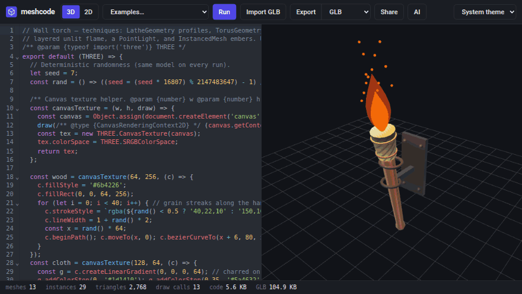

<sub>Recorded with `pnpm demo:gif` (headless Chrome + ImageMagick).</sub>

The project has two parts:

- **[The app](#the-app)**: a code editor with a live 3D/2D preview that runs in the browser.
- **[The research](#research-files-hybrid-or-code)**: an open benchmark that answers one question: **is it more efficient to ship game assets as files (GLB/PNG), as code, or as a hybrid of both?** AI coding agents increasingly build games with no asset files at all, where every mesh, texture and effect is code. This study measures what that costs at runtime.

> Status: **work in progress**. App (3D + 2D), engine export, optional AI, CLI and the PC benchmark are done. Pending: measurements on a real Android phone and the final analysis (bootstrap confidence intervals).

<!-- ## Roadmap

- [x] 1. Repo skeleton + research dossier
- [x] 2. `meshcode build` (code → GLB)
- [x] 3. `meshcode decompile` (GLB → code) + silhouette-IoU fidelity metric (+ `--llm` refinement, 3.9)
- [x] 3.5. Web app + PWA
- [x] 3.6. Light/dark theme + detailed examples
- [x] 3.7. 2D mode: images from code (Canvas, SVG, HTML/CSS → PNG/JPG/WebP)
- [x] 3.8. Export to engines: Godot (GDScript), Unity (C#, experimental); Unreal via GLB
- [x] 3.9. Optional AI: local models or your own API key (generate, repair, refine imports)
- [x] 3.10. README demo GIF
- [x] 3.11. Model ↔ code: click a part to select its code, cursor to outline parts
- [x] 3.12. 3D animation from code (rigid parts → GLB keyframes)
- [x] 4. Benchmark game in three variants (controlled + real-asset studies)
- [ ] 5. Measurement harness (desktop done, Android pending)
- [ ] 6. Analysis, charts, release + DOI -->

## The app

### What it is

meshcode is an editor where a 3D model or a 2D image **is a small file of code**: a three.js module for 3D, and a Canvas script, SVG or HTML/CSS for 2D. You write the code on one side and see the result live on the other. There is nothing to install, no account and no server: everything runs in your browser.

### What it does

| | |
|---|---|
| **3D models from code** | Runs a three.js module and shows it live with orbit controls. The footer counts meshes, instances, triangles and draw calls, and compares the size of the code with the size of the exported GLB. |
| **Export** | GLB (with animation), Godot 4 GDScript (`.gd`) or Unity C# (`.cs`) in 3D; PNG, JPG, WebP (or SVG as is) in 2D. |
| **GLB → code** | **Import GLB** (or drop a `.glb` anywhere) turns a model into editable code, and checks that the code rebuilds the same model. |
| **2D images from code** | Canvas, SVG or HTML/CSS → images, sprite sheets and animation clips. |
| **Model ↔ code** | Click a part in the preview to select the code that made it; move the cursor in the code to outline the parts that block creates. |
| **Animation** | An `animate` export moves parts over time; it is exported as a glTF animation. |
| **Share** | A link that contains the code itself (compressed in the URL). No upload. |
| **AI (optional)** | Generate or edit code from a description, with a local model (Ollama, LM Studio…) or your own API key. |

### How to use it

1. Open the [itch.io page](https://llwaitoll.itch.io/meshcode) and run the app in the browser.
2. Choose **3D** or **2D** at the top. Open **Examples…** to load a ready-made model or image.
3. Edit the code on the left. The preview updates while you type (or press **Run** / `Ctrl+Enter`). Errors appear over the preview.
4. In 3D, drag to orbit, scroll to zoom, and click a part to jump to its code.
5. Pick a format next to **Export** and click **Export** to download the file.
6. To start from an existing model, click **Import GLB** or drop a `.glb` on the page.
7. **Share** copies a link with your code inside it. On itch.io the link opens meshcode on its own page (itch.io does not pass a link's data on to the game); if the browser blocks copying there, the link appears in a box to copy by hand.
8. Optional: **AI** opens a prompt bar; set the provider in **Settings** (see [AI](#ai-optional)).

Layout: drag the **⠿ Code** or **⠿ Preview** title onto any side (or use the select), drag the divider to resize, and pick a light or dark theme. In 2D, the preview bar picks the animation clip, pauses it, switches between smooth and crisp (pixel art) filtering, and shows the whole sprite sheet. Your last code in each mode is kept in this browser.

A 3D model is an ES module whose default export receives `THREE` and returns any `Object3D`:

```js
export default (THREE) => new THREE.Mesh(new THREE.BoxGeometry(1, 1, 1), new THREE.MeshStandardMaterial());
```

Your code runs in a sandboxed iframe (opaque origin), so a shared link cannot read this app's storage or touch the page. Inside the sandbox, use the `THREE` argument; `import` statements are not available there.

### Run it locally

```sh
pnpm dev       # http://localhost:5173
pnpm build     # → dist/ (static files; installable as a PWA, works offline, opens .glb files)
```

## Research: files, hybrid or code?

**Question:** in a 3D web game, what runs better: assets shipped as files, assets generated by code at runtime, or a mix? The full lab notebook (in Spanish) is [`research/bitacora.md`](research/bitacora.md); the annotated sources are [`research/fuentes.md`](research/fuentes.md) and [`research/referencias.bib`](research/referencias.bib).

### Design

One original arena shooter that plays itself: 40 drones, 83 crates, 60 barrels, 3000 dust particles and a camera-bot firing 12.5 shots per second (about 816 000 triangles and 80 draw calls per frame). It is built in three variants that differ **only in where the assets come from**:

| | **A · files** | **B · hybrid** | **C · code** |
|---|---|---|---|
| models + textures | GLB (meshopt); PNG, WebP or KTX2 | GLB (meshopt); PNG, WebP or KTX2 | built at runtime (three.js + canvas) |
| effects | flipbook + sprite images | shaders | shaders |
| level layout | `layout.json` | seeded generator | seeded generator |

- **One source of truth.** The files of A and B are baked from the code of C with meshcode, so they match by construction.
- **Deterministic world.** Everything on screen is a function of time: every variant does the same work per frame, at any frame rate.
- **Visual gate before measuring.** Each variant is compared with C pixel by pixel. Thresholds were fixed before the first run: PSNR ≥ 35 dB and ≥ 99 % of pixels within ±8 levels. A negative control (C one frame later) must fail, and it does. ETC1S textures did not pass and were excluded.
- **Real-asset study.** Three CC0 models made by artists (Kenney's `enemy-flying`, KayKit's `cargo_A` and `Barrel_A`), shipped three ways: the original GLB, the code that `meshcode decompile` produces, and a parametric imitation written by hand from measurements.
- **Measured on a real GPU.** Chrome 158, AMD RX 6500 XT, Intel i3-13100F. 30 repetitions per cell in shuffled order: 1440 page loads and 720 runtime runs. GPU time from `EXT_disjoint_timer_query_webgl2`; real VRAM from the amdgpu per-process counter.

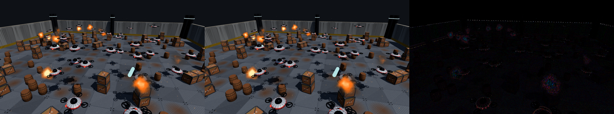

<sub>Code variant | files variant (WebP) | difference ×10. Minimum PSNR 48.9 dB: the variants differ 170 to 660 times less (MSE) than two consecutive frames of the same variant.</sub>

### Short answer: no format wins everything

| question | winner | margin |
|---|---|---|
| Bytes downloaded | **code** | 160 KB vs 736–3632 KB |
| First visit, fast network | **code** | 528 ms vs 678 ms (−22 %) |
| First visit, 4G network | **code** | 0.99 s vs 1.7 s (WebP) and 4.6 s (PNG) |
| Repeat visit | files (WebP) | 261 ms; code takes 16 % longer |
| CPU 4× slower | files (WebP) | 756 ms; code takes 9 % longer |
| GPU cost per frame | **files** | files < hybrid < code: code costs 15 % (1080p) and 23 % (4K) more |
| Real VRAM | KTX2 / smaller atlas | only 7–14 MiB apart, out of about 225 MiB per page |

**Baking wins the frame and the repeat visit; code wins the first visit.** The working recommendation: code as the source, files as the runtime. On the web, shipping code directly pays off when the first visit is what matters.

### Charts

#### Controlled study: bytes vs GPU memory

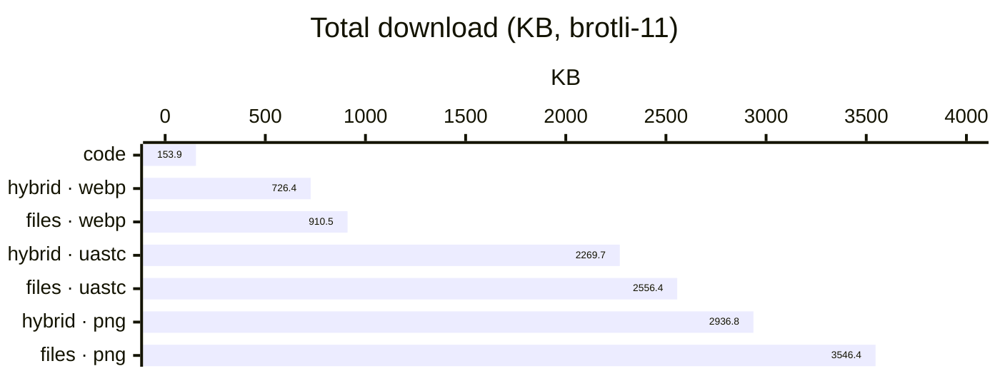

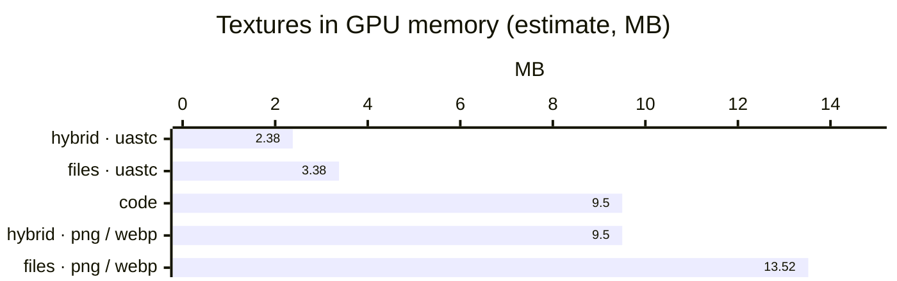

- **The 5 models as code weigh 2.5 KB**; as GLB with WebP, 556 KB. The GLB loader alone (18.6 KB) weighs more than all the models as code.
- **WebP cuts the download, not the VRAM**: PNG and WebP are both decoded to RGBA, 4 bytes per pixel.
- **KTX2 (UASTC) uses 4× less texture VRAM**, but downloads more than WebP and adds 232 KB of transcoder, more than the whole code variant.

#### Real assets: artists' models vs their imitation in code

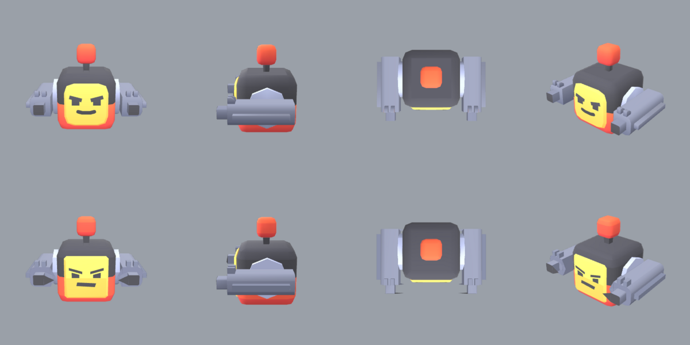

<sub>Kenney's drone: original (top) and code imitation (bottom). Silhouette IoU 0.967, color error 9.4 / 255.</sub>

| prop | silhouette (IoU) | color error | triangles | lines of code | iterations |
|---|---:|---:|---:|---:|---:|
| barrel | 1.000 | 3.0 | 384 → 384 | 12 | 2 |
| crate | 1.000 | 4.3 | 128 → 128 | 19 | 2 |
| drone | 0.967 | 9.4 | 544 → 570 | 61 | 3 |
| shared kit | — | — | — | 99 | — |

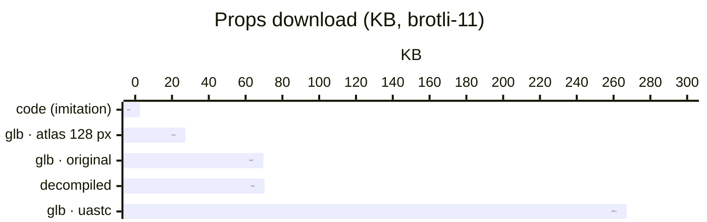

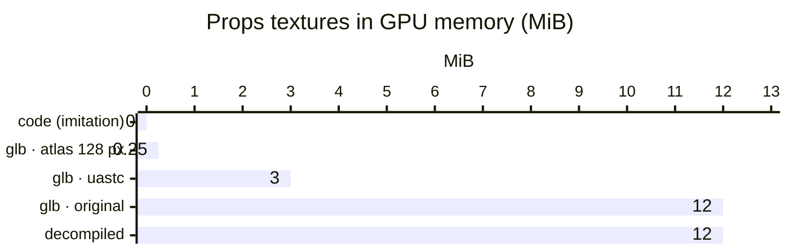

- **Low-poly art is already parametric**: the crate and the barrel come out with the exact same silhouette and triangle count as the originals.
- **Comparing against the file as exported inflates the advantage of code.** The 1024² palette atlases take 12 MiB of VRAM for about 20 colors; downsized to 128 px they look the same (100 % of pixels within ±8) and take 0.25 MiB.
- **A small local LLM could not do it**: dolphin3 (8B), from a text description only, produced 0 usable imitations out of 3.

#### Load time with a real GPU (ms to first frame, median of 30)

First visit = new browser, empty HTTP and shader caches. Repeat visit = reload with warm caches. Fast 4G = 8.1 Mbps down, 165 ms RTT. CPU 4× = main thread 4 times slower.

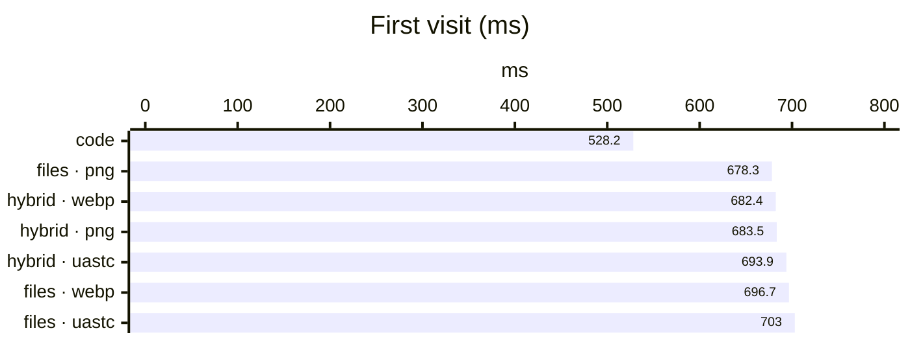

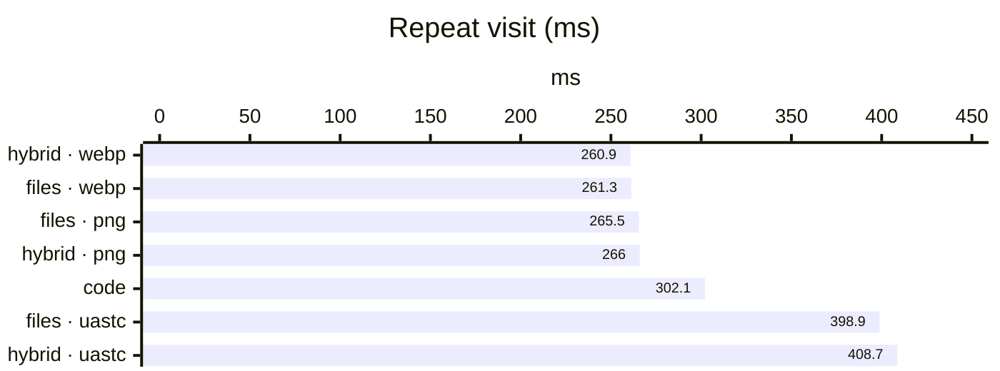

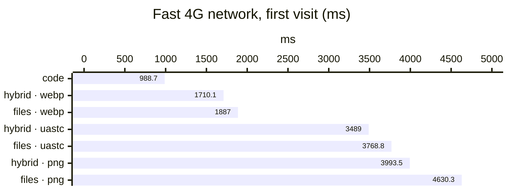

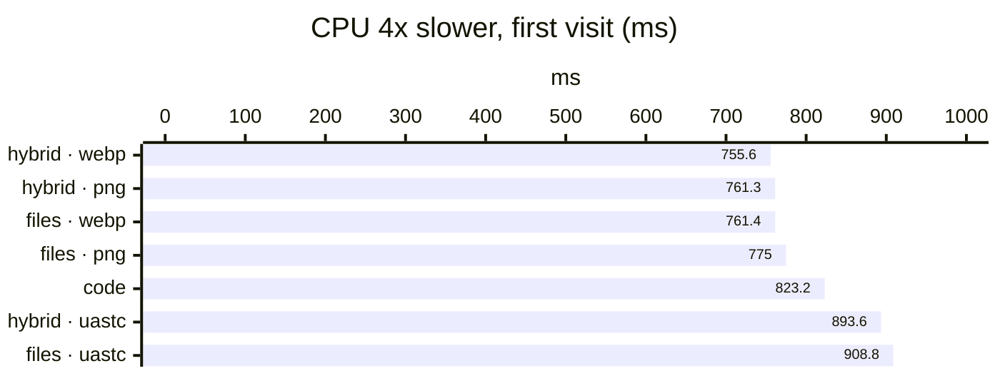

- **Network and CPU cross over.** On a slow network code arrives first (−42 % vs WebP). On a slow CPU or a repeat visit it loses (+9 % and +16 %): it regenerates everything on every load, while files come from the cache.
- **KTX2 is the slowest delivery almost everywhere**: WASM transcoding adds about 200 ms on the first visit and 140 ms on the repeat one.
- **With real art, the deliveries tie** (≤ 3 % apart). The code imitation is the fastest on a repeat visit (−13 %), because its props have no textures.

#### GPU cost per frame (4K, no vsync, median of 30)

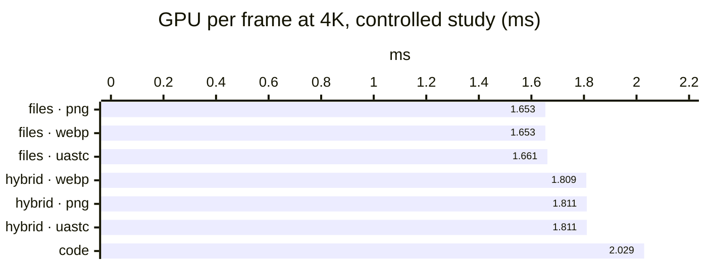

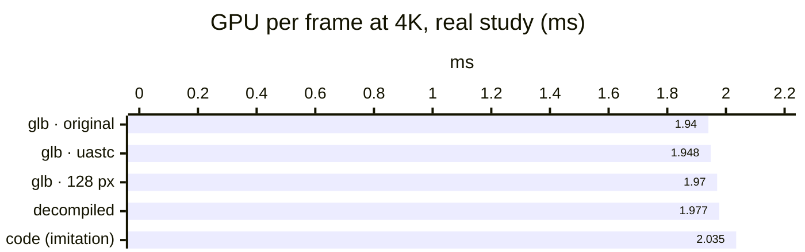

- **The texture format does not change the cost per frame**: PNG, WebP and UASTC stay within 0.5 %. KTX2 only saves memory.
- **Shader effects cost GPU**: files vs hybrid only differ in the effects (flipbook vs procedural noise): +7 % at 1080p, +10 % at 4K, growing with the pixel count.
- **Models generated in code cost 7–12 % more GPU** than the same models as GLB, with the same triangles, draw calls and programs. Not explained yet (hypotheses: meshopt's triangle order, canvas texture state, attribute quantization).
- In absolute terms the scene is light for this GPU (every variant runs above 380 fps at 4K). The same percentages would matter on a phone.

### Key findings

1. **Baking wins the frame and the repeat visit; code wins the first visit.** No format wins everything.
2. **The cost of code is in procedural textures, not in procedural geometry.** With real low-poly art (vertex colors, no textures) the code imitation ties with the GLB on the first visit and beats it on the repeat one.
3. **One implementation detail can flip the conclusion.** By default Chrome draws the 2D canvas on the GPU, which cost the code variant 30 MiB of VRAM and 140 ms on the first visit. One option (`getContext('2d', { willReadFrequently: true })`) turned it from losing to winning.
4. **What is compact is the description, not the language.** Code decompiled automatically weighs the same as the GLB. Only parametric code (a lathe, a rounded box) is small, and writing it requires understanding the shape.

### Limits

One PC and no phone yet; "CPU 4×" slows the main thread, not the GPU or the workers. The real props are three low-poly models: no characters, organic meshes or skinning. The imitations were written by a frontier AI agent with access to the originals, which is converting an asset, not creating one from scratch. The machine was not dedicated (the harness waited for the system load to drop before each measurement). Two differences remain unexplained: +7–12 % GPU and +9 MiB VRAM for models generated in code.

### Reproduce

```sh
pnpm bench:build                # bake assets and build the 3 game pages
pnpm bench:check [--set real]   # visual equivalence gate
pnpm bench:real                 # per-model gate of the imitations
pnpm bench:static [--set real]  # bytes and estimated VRAM
pnpm bench:run                  # real-GPU measurements (~3.5 h)
pnpm bench:preview              # play the game at http://localhost:4173
```

Details in [`bench/README.md`](bench/README.md). Results: [`bench/results/`](bench/results/) (full tables with IQR in [`run/summary.md`](bench/results/run/summary.md), raw rows in `loads.csv` and `runtime.csv`).

## Animation: moving parts from code

Add an `animate` export to move, rotate or scale parts over time. meshcode samples it (`fps`, default 30) into keyframes: the viewer loops them and **Export GLB** (and `meshcode build`) writes them as a glTF animation, which Blender, Godot, Unity and Unreal import.

```js
export const duration = 3; // seconds
export const animate = (root, t) => {
  // absolute values from t (no `+=`); find parts by name. t = 0 is the rest pose.
  root.getObjectByName('lid_hinge').rotation.x = -1.1 * (0.5 + 0.5 * Math.cos((2 * Math.PI * t) / duration));
};
export default (THREE) => { /* … */ };
```

Only node position/rotation/scale are animated (no skeletons, per-instance or material animation). The Godot/Unity scripts do not carry the animation: export GLB for that. Animations in an imported GLB are not turned into code yet.

## 2D mode: images from code

Switch to **2D** to turn code into **PNG / JPG / WebP** (and keep SVG as SVG). Three kinds of source, detected automatically:

| Source | Contract |
|---|---|
| Canvas (JS) | `export default (ctx, { width, height, frame, frames, t, u, clip, ease, rig }) => { … }` plus optional `export const size = [w, h]`, `frames = N` (sprite sheet), `duration`, `columns`, `fps`, `smooth`, `clips = { idle: { duration, fps, loop }, … }` |
| SVG | plain SVG markup (size from `width`/`height` or `viewBox`) |
| HTML + CSS | markup with a `<style>` block; size from a comment like `<!-- size: 512x256 -->`. Rendered through SVG `foreignObject`: use system fonts and inline (`data:`) images. Works in Chromium/Firefox, not Safari. |

Multi-frame canvas modules become a **sprite sheet** (frames left→right, then down), and the preview plays them; click the preview to see the whole sheet. With `clips`, one module holds several animations (idle, jump…); pick one in the preview bar, and **Export** writes that clip's sheet. `ease` and `rig` are stateless helpers (easing, springs, pivots, follow-through) so the live preview and the baked sheet give identical poses.

## Examples

Original models in [`examples/`](examples/), each showing a technique (all load from the app's **Examples** menu):

| Example | Techniques |
|---|---|
| `torch.js` | LatheGeometry profiles, torus rings, canvas textures, unlit layered flame, PointLight, instanced embers |
| `chest.js` | half-cylinder lid on a hinge pivot, animated with `animate` (opens and closes), torus arcs, 90-coin InstancedMesh pile |
| `barrel.js` | one profile function drives the lathed body *and* the hoops, wrapping stave texture |
| `forest.js` | seeded PRNG (change `SEED`), rejection sampling, displaced ground, 265 instances in 5 draw calls |
| `spaceship.js` | lathed fuselage, wings extruded from a 2D `Shape`, unlit engine glow (forward = −Z) |
| `dungeon-kit.js` | modular pieces on a 2 m grid, arched doorway from a `Shape` with a hole, metre-scaled UVs |

Every example is checked in CI: valid GLB (Khronos validator), and `decompile` rebuilds it with silhouette IoU 1.0 and identical materials.

2D examples in [`examples/2d/`](examples/2d/):

| Example | Techniques |
|---|---|
| `bouncy-slime-rig.js` | vector rig with hierarchical pivots, volume-preserving squash & stretch, spring, 3 clips (idle, jump, happy) |
| `adventurer-walk.js` | pixel art at 16×16, outline from the alpha channel, ×4 nearest-neighbour scale, 8-frame walk cycle sheet |
| `cobblestone-texture.js` | seamless Voronoi stones (distances wrap around the edges), mortar, grain |
| `parallax-layers.js` | 3 layers (sky, mountains, hills) as frames; periodic ridges so every layer scrolls seamlessly |
| `item-icons.svg` | three icons sharing SVG gradients |
| `ui-kit.html` | buttons and health/mana bars with CSS gradients and shadows only |

## Game engines

Export the **resulting scene** of a model as engine-native code. This is not a JavaScript translator: the model runs first, so loops, randomness and canvas textures are already resolved. In the app: **Export → Godot .gd / Unity .cs**. From the CLI:

```sh
pnpm meshcode export examples/chest.js --to godot          # → chest.gd
pnpm meshcode export examples/chest.js --to unity          # → ChestModel.cs
pnpm meshcode export model.glb --to godot -o Model.gd      # .glb input works too
```

| Engine | Output | How to use | Status |
|---|---|---|---|
| **Godot 4** | GDScript (`@tool extends Node3D`) | attach to a `Node3D`; the model is built under a child named `Model`, also live in the editor | **verified**: every example runs in headless Godot 4.6.3 with the same meshes, instances and world AABBs as three.js |
| **Unity** | C# `MonoBehaviour` | add to an empty GameObject; built in `Awake()`; Built-in and URP | experimental (not compiled in CI); Z mirrored to left-handed, winding checked by tests |
| **Unreal 5** | — | export **GLB** and import it (Interchange glTF importer, native since UE 5.1) | via GLB |

Godot keeps primitives editable (`BoxMesh`, `CylinderMesh`, `SphereMesh`, `PlaneMesh`) when the mesh has no texture; everything else is exact vertex data in an `ArrayMesh`, and `InstancedMesh` becomes a `MultiMesh`. Light intensities use different units in each engine: tune them after import.

## AI (optional)

meshcode works fully without AI. If you want it, click **AI** in the app and open **Settings**:

| Provider | Examples | Key |
|---|---|---|
| OpenAI-compatible | Ollama, LM Studio, llama.cpp server, OpenAI, OpenRouter, Groq | none for local servers |
| Anthropic | Claude (default `claude-opus-5-5`), through the official SDK | your own API key |

- **Generate**: describe a model (3D mode) or an image (2D mode); the code streams into the editor.
- **Edit**: describe a change to the current code; you get a diff to accept or reject (per chunk or all at once).
- **Repair**: every answer runs in the sandbox; errors or an empty result go back to the model, up to 3 times.
- **Visual critique** (vision models): the first working result is rendered (four views, or the image) and shown to the model once.
- **Refine import**: after importing a GLB, rewrite the generated code as readable code. Large vertex and image data are replaced by placeholders before the model sees them. The rewrite is **kept only if** the silhouettes still match the GLB from 6 views (IoU ≥ 0.95) and the materials are identical.

Privacy: requests go straight from your browser to the provider, with no meshcode server in between. The key stays in the app page, never in the sandbox that runs code. It lives in the tab only, unless you tick *Remember*, which saves it in this browser's storage: any page on the same origin can read it. On a shared host (itch.io serves browser games from a shared domain) that can include other people's pages, so leave *Remember* off there. Ollama answers pages on `localhost` as is; for any other origin, start it with `OLLAMA_ORIGINS=<app origin> ollama serve` (the exact command is shown in Settings).

Expect small local models (≈8B) to write simple, sometimes wrong 3D code; larger models do much better. This matches the published benchmarks in [`research/fuentes.md`](research/fuentes.md) and the benchmark above (0 of 3 usable imitations with dolphin3).

## CLI

```sh
pnpm meshcode build examples/torch.js -o torch.glb   # code → GLB
pnpm meshcode build examples/torch.js --meshopt      # + dedup and EXT_meshopt_compression
pnpm meshcode inspect torch.glb                      # meshes, instances, triangles, bbox
pnpm meshcode decompile torch.glb -o torch.js        # GLB → code (+ texture files), then checks fidelity
pnpm meshcode verify a.glb b.js --min 0.99           # silhouette IoU + material diff of any two models
pnpm meshcode build examples/2d/adventurer-walk.js -o walk.png   # 2D: output extension picks PNG / JPG / WebP
pnpm meshcode build examples/2d/item-icons.svg                    # SVG or HTML in → PNG out

# Optional AI (default: local Ollama at http://localhost:11434/v1, first listed model)
pnpm meshcode generate "a wooden chair with a woven seat" -o chair.js
pnpm meshcode generate "a 32×32 health potion icon" --2d --critique --model llava
pnpm meshcode generate "a treasure chest" --provider anthropic     # ANTHROPIC_API_KEY
pnpm meshcode decompile model.glb --llm -o model.js                 # readable rewrite, kept only if it matches
```

`decompile` turns geometry that exactly matches a three.js primitive (box, plane, sphere, cylinder, cone) into a constructor call, and keeps anything else losslessly as base64 vertex data. Textures are written next to the module with their original bytes. Every decompile rebuilds the result and reports **silhouette IoU** (6 orthographic views, CPU-rasterized, deterministic) and a **material diff**, because IoU alone is blind to shading.

It runs in headless Google Chrome (set `MESHCODE_CHROME` to use another Chromium binary), so canvas textures, `InstancedMesh` and every three.js API behave as in the browser. See [`examples/`](examples/).

> Note: meshopt is not always smaller. On tiny meshes the extension overhead can exceed the savings (`test/fixtures/instanced.js`: 2.9 KB raw → 4.5 KB meshopt).

## Development

Requires Node ≥ 22 and **pnpm** (pinned via `packageManager`; run `corepack enable`).

```sh
pnpm install --frozen-lockfile
pnpm test
MESHCODE_OLLAMA_MODEL=dolphin3 pnpm test   # also runs one real local model (slow, opt-in)
```

AI tests use a scripted fake server (OpenAI-compatible and Anthropic), so they are deterministic and need no key.

npm is not used. pnpm is configured in [`pnpm-workspace.yaml`](pnpm-workspace.yaml) to block dependency install scripts and to skip package versions published less than 3 days ago. CI actions are pinned to commit SHAs.

## License

- Code: [MIT](LICENSE).
- Research text and benchmark data (`research/`, benchmark results): [CC BY 4.0](https://creativecommons.org/licenses/by/4.0/).
- Third-party CC0 assets keep their own licenses (listed next to them).

## Citation

See [`CITATION.cff`](CITATION.cff) or GitHub's "Cite this repository" button.
